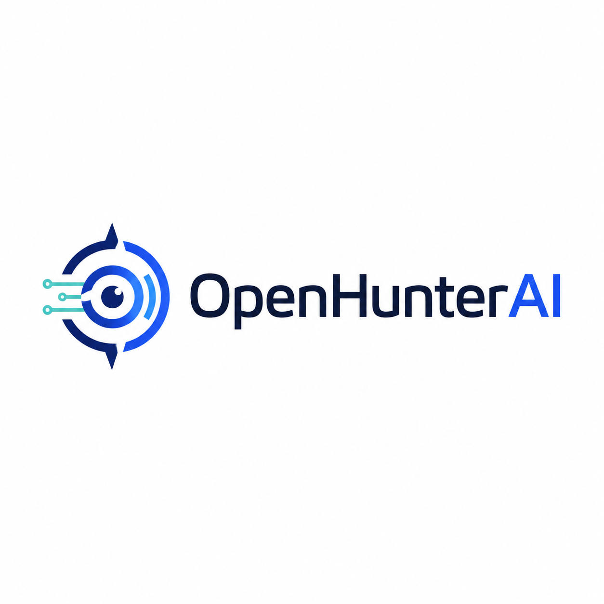
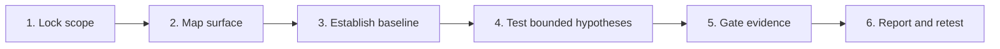
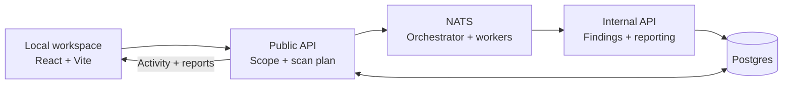

<p align="center">
  
</p>

<h1 align="center">OpenHunterAI</h1>

<p align="center">
  <strong>Your local AI red team.</strong><br>
  Attacker-style reasoning for web, API, and LLM application security.
</p>

<p align="center">
  <a href="https://github.com/LumosLab-Innovation/OpenHunterAI/actions/workflows/ci.yml"></a>
  <a href="https://github.com/LumosLab-Innovation/OpenHunterAI/releases"></a>
  <a href="LICENSE"></a>
  <a href="https://github.com/LumosLab-Innovation/OpenHunterAI/stargazers"></a>
</p>

<p align="center">
  <a href="#quick-start">Quick start</a> ·
  <a href="#coding-agent-skill">Agent skill</a> ·
  <a href="#assessment-model">Assessment model</a> ·
  <a href="#architecture">Architecture</a> ·
  <a href="docs/README.md">Docs</a> ·
  <a href="#star-history">Star history</a>
</p>

OpenHunterAI brings scope, scan activity, findings, and remediation into one
local workspace. Start without an account, connect your model providers, and
assess **verified public applications you own or are authorized to test**.

| Capability | What you get |
| --- | --- |
| Local workspace | No signup; projects and scan records in your local database |
| Explicit scope | Domain verification, deterministic plans, human approval gates |
| Multiple signal sources | Browser inspection, recon, ZAP, and a Nuclei adapter |
| AI-assisted investigation | OpenHack/Strix adapter boundaries; bring your own runtimes |
| Evidence & remediation | Sanitized findings, coverage gaps, fix guidance, manual retest |
| Portable workflow | A skill for Codex, Claude Code, Gemini CLI, Grok Build, and OMP |

> **Alpha.** Integration coverage depends on configured runtimes. A healthy
> workspace or an empty report does not prove a target is secure.

## Assessment model

OpenHunterAI keeps the useful core of the
[48bf9036 technical requirements](https://github.com/LumosLab-Innovation/OpenHunterAI/blob/48bf9036debf797cef3d24308c3cfa1ec2a20c15/README.md):
assess externally observable behaviour from an attacker's perspective. Source
code is not required. Every run stays constrained to a verified public target
and an approved scope.



| Stage | Output | Control |
| --- | --- | --- |
| Scope lock | Verified host, approved paths, scan plan | Authorization before work begins |
| Surface mapping | Browser and recon signals | Public, in-scope surface only |
| Baseline | Normal responses and coverage context | Bounded workers and adapter policies |
| Hypothesis testing | Candidate security signals | No destructive actions; sensitive validation needs approval |
| Evidence gate | Sanitized, reproducible finding | Separate observed signals from analyst judgement |
| Report and retest | Fix guidance, limitations, manual confirmation | A human owns impact decisions and closure |

OpenAPI/Swagger descriptions, Postman examples, sanitized HTTP captures, and
dedicated test accounts can help define the agreed test surface. Automated
import or retention of raw sensitive traffic is not a promised capability.

## Quick start

Requires **Git, Node.js 22+, and Docker with Compose v2**.

```bash
git clone https://github.com/LumosLab-Innovation/OpenHunterAI.git
cd OpenHunterAI
node ops/local.mjs start
```

Open **[localhost:3001](http://localhost:3001)**. First startup builds the images,
applies database migrations, and creates a private `.env.local` with generated secrets.

1. Set provider keys and model IDs in `.env.local`; run `node ops/local.mjs restart`.
2. Create a project and verify its public domain.
3. Authorize the scope, start a scan, and review its activity and coverage.

| Command | Purpose |
| --- | --- |
| `node ops/local.mjs status` | Inspect services |
| `node ops/local.mjs logs public-api` | Diagnose API errors |
| `node ops/local.mjs stop` | Stop; keep database volumes |

**Included:** browser inspection, ZAP, recon, and the Nuclei adapter.
**Bring separately:** OpenHack and Strix runtimes.
Optional interactive **target-login** capture: `node ops/local.mjs start --with-browser`.

Before scanning, resolve the [Nuclei template-policy blocker](docs/PUBLIC_RELEASE_READINESS.md#open-gaps).
The adapter is packaged, but a reviewed template bundle is not yet supplied.

Local means the workspace runs on your machine, **not** permission to scan
localhost/private networks. Keep its ports on loopback.
[Setup, model configuration, and troubleshooting →](docs/LOCAL_WORKSPACE.md)

## Coding-agent skill

Run in the application repository you want your agent to assess:

```bash
npx --yes skills add LumosLab-Innovation/OpenHunterAI --skill openhunter --agent codex claude-code gemini-cli grok --yes
```

Reload your coding agent, then ask:

> Use OpenHunter to check my workspace and prepare a scoped security assessment.
> Wait for my approval before starting a scan.

OMP discovers the shared `.agents/skills` installation through its Agents
provider. The skill includes a read-only API helper; installation does not start
a scan. [Client compatibility →](docs/LOCAL_WORKSPACE.md#coding-agent-skill)

## Architecture



The public API builds the plan; Go workers execute it through bounded adapters.
Signals pass through the findings policy before entering reports. Reporting is
a backend service, not a separate scan worker.

[Runtime & data flow](docs/ARCHITECTURE.md) ·
[Worker mapping](docs/WORKER_SPEC.md) ·
[Integration setup](infra/INTEGRATIONS.md)

## Documentation

| Start here | Go deeper |
| --- | --- |
| [Local setup](docs/LOCAL_WORKSPACE.md) | [Architecture & data model](docs/ARCHITECTURE.md) |
| [Product overview](docs/ONE-PAGE.md) | [Product requirements](docs/PRD.md) |
| [Agent workflow](skills/openhunter/references/workflow.md) | [LLM routing](docs/LLM_PROVIDER_SPEC.md) |
| [Security guardrails](docs/SECURITY_GUARDRAILS.md) | [Acceptance & release gates](docs/ACCEPTANCE_CRITERIA.md) |

[All documentation](docs/README.md) ·
[Known limitations](docs/PUBLIC_RELEASE_READINESS.md#open-gaps) ·
[Historical technical specification](docs/archive/technical-spec-433ecf7.md)

## Community & license

[Report a bug](https://github.com/LumosLab-Innovation/OpenHunterAI/issues/new/choose),
suggest an improvement, or help clarify the docs.
Read [contribution rules](CONTRIBUTING.md) first; disclose vulnerabilities
[privately](SECURITY.md), without credentials or raw target data.

Source-available under [PolyForm Noncommercial 1.0.0](LICENSE).
Commercial licensing: [LICENSING.md](LICENSING.md).
[Upstream tools and attribution](docs/UPSTREAM_SOURCES.md) retain their own notices.

## Star history

[](https://www.star-history.com/#LumosLab-Innovation/OpenHunterAI&Date)
