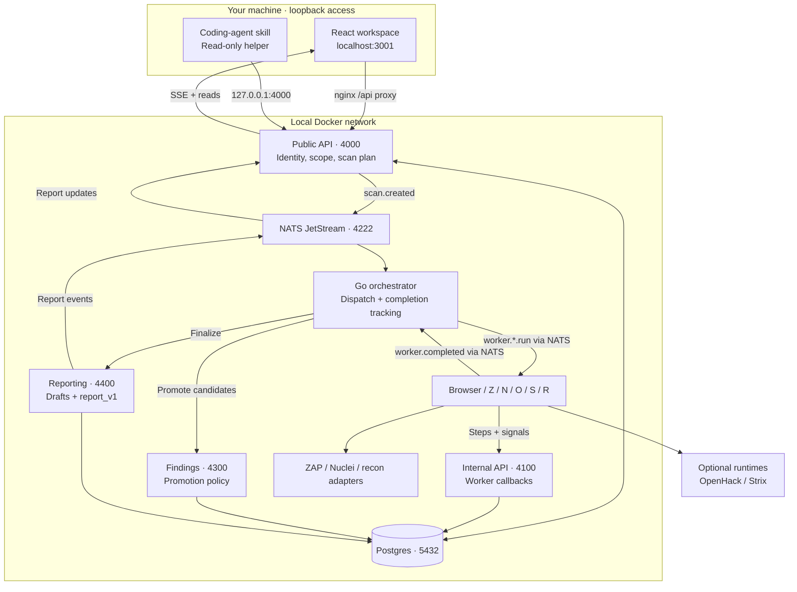
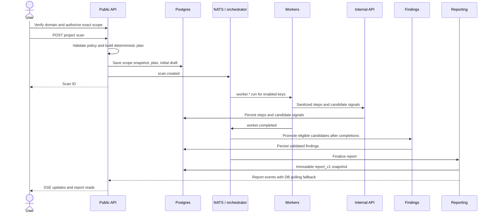
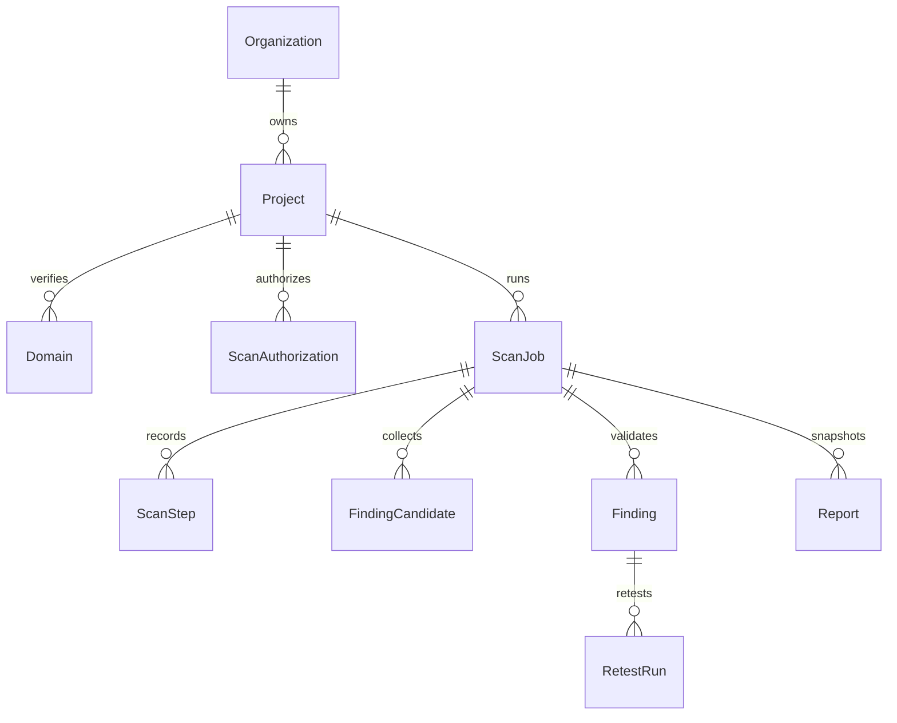

# Architecture

This describes the checked-in local runtime, not a claim about live cloud
deployments. Start with [local setup](LOCAL_WORKSPACE.md); service definitions are
in [compose.local.yml](../compose.local.yml).

## Runtime

Browser inspection runs inside its worker. Interactive target-login capture is a
separate optional `browser-session` service; it is not workspace authentication.
OpenHack and Strix worker processes start with the local stack, but their tool
runtimes must be supplied separately. Nuclei's adapter/binary is packaged; its
reviewed template bundle and runtime configuration remain a release blocker.

| Component | Source | Local exposure |
| --- | --- | --- |
| UI + same-origin proxy | [frontend](../frontend/) | `127.0.0.1:3001` |
| Public API | [gateway/public-api](../gateway/public-api/) | `127.0.0.1:4000` |
| Callback API | [gateway/internal-api](../gateway/internal-api/) | Internal `4100` |
| Findings / reporting | [backend](../backend/) | Internal `4300 / 4400` |
| Browser-session capture | [backend/browser-session](../backend/browser-session/) | Optional, internal `4700` |
| Workers / orchestrator | [workers](../workers/) | Internal health ports `5100–5170` |
| Tool adapters | [integrations](../integrations/) | Internal; [runtime map](../infra/INTEGRATIONS.md) |
| Postgres / NATS | [Compose](../compose.local.yml) | Internal `5432 / 4222`; named volumes |

There is no `report-worker` service. `backend/control-plane` and older
`infra/docker-compose` overlays exist for contributor/hosted workflows; they are
not additional services in the default local stack.

## Scan lifecycle

The planner is [buildScanPlan](../shared/security-core/src/scan-plan.ts), invoked
by [ScansService](../gateway/public-api/src/modules/scans/scans.service.ts).
The orchestrator dispatches that plan; an LLM does not choose the worker set.

Completion tracking normalizes plan keys into runtime IDs. It waits for expected
worker completions; `completed` does not mean every check succeeded. Inspect step
states and report coverage. Free-mode result limits are enforced at promotion
and report generation; immediate cancellation of other workers after the first
valuable finding is not implemented in fan-in.

Reports are generated by [backend/reporting](../backend/reporting/src/server.ts).
The public API serves snapshots, latest-status overlays, and DOCX/CSV/JSON/HTML/PDF
exports. Retest is separately requested for one finding, not a background loop.

## Data model

[Prisma](../shared/db/prisma/schema.prisma) is the database authority.

| Data | Storage rule |
| --- | --- |
| Scope, steps, findings, drafts, reports | Structured records in Postgres |
| Test-account credentials / captured target sessions | Encrypted credential and storage-state fields; never plaintext evidence |
| Hosted workspace access | Password hashes and session-token hashes |
| Sanitized report evidence | Sanitized JSON and controlled evidence references |
| Queue progress | NATS JetStream and KV; local queue volume |
| Raw HAR / sensitive request bodies / secrets | Must not enter logs, prompts, reports, or exports |

## Trust boundaries

| Mode | Access | Entitlements |
| --- | --- | --- |
| Local | Reserved local identity, loopback Host/Origin checks, no workspace login | Hosted payment checks bypassed only for the reserved local organization; scan safety quotas remain |
| Hosted | Existing account/session flow with `OPENHUNTER_MODE=hosted` | Existing hosted checks retained |

Local mode trusts local machine processes. Do not expose its ports through a
tunnel, shared reverse proxy, or LAN bind. Published host ports are loopback even
though the API binds `0.0.0.0` **inside** its container.

Model-provider calls can leave the machine. LLM context must be sanitized; a local
database is not a promise of fully offline inference. See
[LLM routing](LLM_PROVIDER_SPEC.md) and [guardrails](SECURITY_GUARDRAILS.md).

## Deployment status

- [Local Compose](../compose.local.yml) is the documented end-user entry point.
- [Staging overlays](../infra/docker-compose/) and [Cloud Build configuration](../infra/cloudbuild/pipeline-runtime.yaml)
  are checked-in deployment assets, not proof of a running deployment.
- Recon is included locally and in developer integration tooling; the staging
  worker overlay and cloud build pipeline do not include it.
- The [managed-runtime ADR](adr/2026-06-16-managed-scan-runtime.md) is a proposal.
  NATS has not been replaced by Pub/Sub in the local runtime.

See [release gaps](PUBLIC_RELEASE_READINESS.md#open-gaps) before making
end-to-end or production-readiness claims.
