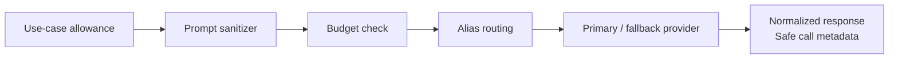

# LLM provider specification

Business logic calls [LLMGateway](../shared/llm-gateway-core/src/gateway.ts), using
a use case rather than a provider SDK or model ID. Configuration belongs in
[llm-gateway-core](../shared/llm-gateway-core/).

## Aliases and use cases

| Alias | Use cases |
| --- | --- |
| `low_reasoning_model` | `signal_summary`, `candidate_dedupe`, `suspicious_surface_ranking` |
| `high_reasoning_model` | `first_valuable_finding`, `attacker_hypothesis`, `validation_plan`, `access_control_reasoning`, `api_reasoning`, `llm_app_reasoning`, `report_generation`, `fix_prompt`, `retest_reasoning` |

These are supported routing identifiers, not a claim that every use case is
invoked in every scan. Current backend call sites include
[findings triage](../backend/findings/src/triage.ts) and
[report fix prompts](../backend/reporting/src/llm.ts).
OpenHack/Strix run behind tool adapters with separately configured runtimes;
they are not automatically clients of this TypeScript gateway.

## Gateway flow

Requests carry project/scan identity, package tier, prompts, and optional compact
context. Responses expose output, usage, latency, and typed errors. Raw prompts
must not appear in logs.

## Local configuration

Set values in the private `.env.local`, then run `node ops/local.mjs restart`.
Use [the local example](../.env.local.example) for keys and Compose-supported
settings; model IDs must be valid for your provider account.

| Setting | Meaning |
| --- | --- |
| `LLM_LOW_REASONING_PROVIDER` / `LLM_LOW_REASONING_MODEL` | Low-reasoning route |
| `LLM_HIGH_REASONING_PROVIDER` / `LLM_HIGH_REASONING_MODEL` | High-reasoning route |
| `LLM_*_FALLBACK_PROVIDER` / `LLM_*_FALLBACK_MODEL` | Fallback route per alias |
| `OPENAI_API_KEY` / `DEEPSEEK_API_KEY` | Keys passed into the default local stack |
| `ORCAROUTER_API_KEY` | Named OrcaRouter Cyber Inference provider key (API key or PKCE-issued) |

The gateway also implements a `claude` adapter using `ANTHROPIC_API_KEY`, but the
default local Compose file does not pass that key through. A gateway adapter's
existence is not the same as a supported local setup option.

### OrcaRouter Cyber Inference

`LLM_*_REASONING_PROVIDER=orcarouter` routes an alias through the named
[OrcaRouter](https://www.orcarouter.ai) Cyber Inference provider
(`https://api.orcarouter.ai/v1`, OpenAI-compatible, Bearer auth). It is the
provider for authorized, scoped security work: cyber models for red teams and
gateway controls for blue teams. The default model is `orcarouter/auto`;
`orca/orcacyber-ultra-1.0` and `orca/orcacyber-zero-1.5` are recommended for
workspaces verified for the cyber tier, and `orcarouter/fusion` is the general
fallback.

Credentials come from either a pasted API key or OAuth 2.0 + PKCE (S256,
loopback redirect), both configured on **Setup & models**. Model discovery uses
`GET /v1/models?capability=chat` with the stored key; a small verified fallback
catalog is used only when discovery fails. A relay `401` is terminal until the
user reconnects — there is no refresh grant. See
[ORCAROUTER.md](ORCAROUTER.md).

Local Compose explicitly supplies model values; bare gateway defaults in
[config.ts](../shared/llm-gateway-core/src/config.ts) differ. Do not rely on those
defaults as proof that a model exists or your account can access it. Empty fallback
settings resolve to the gateway defaults; they do not disable fallback.

The Setup screen checks key/model presence only. It does not verify provider
authentication, balance, availability, or tool coverage.

## Budgets

Current [package budgets](../shared/llm-gateway-core/src/config.ts):

| Package | Calls per scan | Input tokens/call¹ | Output tokens/call | Timeout |
| --- | --- | --- | --- | --- |
| `free_hunter` | 3 | 6,000 | 1,200 | 30 s |
| `ai_blackhat_mindset_check` | 24 | 22,000 | 5,000 | 75 s |
| `monitor_workspace` | 4 | 12,000 | 2,500 | 45 s |
| `enterprise_payg` | 60 | 30,000 | 6,000 | 90 s |

¹ Input budgeting uses an estimate, not the provider's tokenizer.

Budgets are in-memory per gateway instance, not a durable cross-service spending
limit. They differ from [scan-mode quotas](WORKER_SPEC.md#3-profiles-by-target-type).
Local projects use the existing enterprise package for gateway budgeting even
when a free scan profile is selected.

Free allows high reasoning for `first_valuable_finding`, but not every high-reasoning
use case. Exhaustion must stop extra calls and preserve an explicit limitation,
never fabricated output. The gateway defaults to one attempt per provider; report
fix guidance has a deterministic fallback if generation fails.

## Data and output policy

Never send raw credentials, passwords, API keys, authorization headers, cookies,
tokens, HAR, browser storage, sensitive requests/responses, or private data to a
provider. Detected secrets are represented only by masked fingerprints or metadata.

LLM output is recommendation-only. It cannot create a finding, invent evidence,
reference an unknown finding ID, or override severity, scope, quotas, or approval
policy. Local inference hosting does not relax these constraints.

## Required verification

- Alias/environment resolution and use-case mapping.
- Package allowance, token/call budgets, timeout/retry/fallback behavior.
- Sanitization of prompts, compact context, output, and audit metadata.
- No direct provider calls from business logic.
- Explicit provider failure and fallback status; no invented findings.

Tests: [gateway.test.ts](../shared/llm-gateway-core/src/gateway.test.ts) and
[package-model.test.ts](../shared/llm-gateway-core/src/package-model.test.ts).
