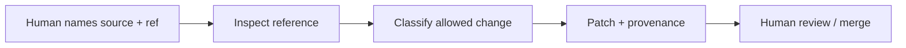

# Manual upstream enrichment

This policy governs updates from the [upstream registry](UPSTREAM_SOURCES.md).
It is subordinate to [security guardrails](SECURITY_GUARDRAILS.md),
[acceptance criteria](ACCEPTANCE_CRITERIA.md), and [AGENTS.md](../AGENTS.md).

## Manual only

The existing enrichment workflow is a human-requested Claude Code run naming a
source and ref. It produces a normal repository patch for human review.
No upstream code is executed during enrichment.

Do not add automatic sync, scheduled pulls, CI upstream-diff jobs, enrichment
bots, or product-runtime fetching of registry content.

## Review flow



Read the registry and named source; use only the relevant in-scope material.
Reject changes that broaden product scope, fabricate findings, or bypass approval.

| Update type | Permitted change | Required constraint |
| --- | --- | --- |
| `playbook_update` | Hunter/scenario/review guidance | Existing hunter ID; no direct execution |
| `reasoning_update` | Sanitized high-reasoning guidance | Preserve intensity, approval, and scope |
| `runtime_capability_update` | Existing adapter contract/config/parser | Reviewed pinned version, tests, no new scope |
| `curated_detection_content_update` | Reviewed allowlisted template | Target/flag mapping and intensity compatibility |
| `out_of_scope_update` | Reject or record future research | Do not implement |

Adding a submodule, full vendored repository, new worker/integration, runtime
dependency, or production tool/template activation requires explicit owner
approval and a proposal first. ZAP remains passive by default; Nuclei must remain
reviewed-allowlist only.

## Provenance

Every enriched item uses
[HunterProvenance](../shared/security-core/src/hunter-provenance.ts):

```ts
source: {
  upstreamId,
  upstreamUrl,
  upstreamRef,
  upstreamPath,
  importMode,
  importedBy: "manual_claude_code_run",
  importedAt, // optional; exclude from snapshot/equality assertions
  licenseNote
}
```

Optional fields follow the source type. `hunterId` must be one the deterministic
[planner](../shared/security-core/src/scan-plan.ts) can emit.
Keep attribution and bundled notices; a reference is not a runtime installation.

## Example request

> Enrich OpenHack auth workflow and Strix IDOR reasoning guidance from the named
> Claude-BugHunter ref. Use only in-scope material, add provenance, and produce
> a patch. No submodule, full vendoring, execution, or automation.

Reject private/internal/metadata scans, malware, persistence, stealth/evasion,
brute force, DoS/destruction, secret exfiltration, cloud/identity/VPN attacks,
mobile APK audits, SAST/SCA/secrets scanning, supply-chain recon, and post-exploitation.
