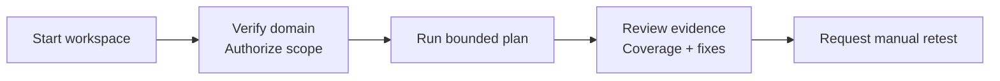

# Product requirements

OpenHunterAI is a local-first AI red-team workspace for authorized external
web, API, and AI/LLM application testing. This document defines the product
contract; [release status](PUBLIC_RELEASE_READINESS.md) records implementation gaps.

## Audience and outcome

| User | Outcome |
| --- | --- |
| Application owner | Understand tested scope, validated risks, coverage, and next steps |
| Developer | Inspect sanitized evidence and remediation guidance; request a narrow retest |
| Security tester | Prepare bounded attacker hypotheses without losing human control |
| Coding-agent user | Read workspace state and follow an explicitly authorized assessment workflow |

The workflow is black-box: repository access is not required by the scanner.
A coding agent may separately inspect or fix the user's application repository
when asked; this does not add SAST or automatic source-code access to OpenHunterAI.

## User journey

Local workspace access has no login or subscription requirement. It does not
waive domain verification, authorization, approval gates, or scan safety quotas.
Hosted deployments retain their existing account/session flow.

## Product vocabulary

| Concept | Values / meaning |
| --- | --- |
| Scan mode | `free_hunter`, `ai_blackhat_mindset_check` |
| Target type | `static_content_website`, `interactive_web_app`, `api_service`, `ai_llm_application` |
| Auth scope | `none`, `one_account`, `two_accounts`; target test accounts, not workspace login |
| Intensity | `safe_discovery`, `controlled_attack_simulation`, `aggressive_staging` |
| Package tier | Existing hosted entitlement identifiers; not another scan intensity |
| Readiness export | A report view/export, not a scan package |
| Monitor Workspace | Existing package vocabulary; does not imply automated monitoring/retests |

Hosted package labels remain Free Hunter, AI Black-hat Mindset Check,
Monitor Workspace, and Enterprise / PAYG. Optional monitor sub-tiers are not
public package names. Local projects use the existing `enterprise_payg` tier to
permit both scan modes without hosted credit checks. License terms are unchanged.

Canonical enums: [packages.ts](../shared/security-core/src/packages.ts).

## Authorization inputs

Every scan needs a verified, unexpired public domain and an explicit authorization:

| Input | Requirement |
| --- | --- |
| Scope | `allowedHosts`, `allowedPaths`, `excludedPaths`; never auto-expand on discovery |
| Execution | Scan mode, target type, intensity, and surface flags |
| Accounts | None / at least one / at least two test accounts according to auth scope |
| Consent | Recorded scope authorization; separate approval for sensitive actions |
| Aggressive staging | Explicit staging/dev/test ownership and risk acceptance |

Surface flags: `has_login`, `has_test_account`, `has_api_docs`,
`has_file_upload`, `has_payment`, `has_admin_dashboard`, `has_webhook`,
`has_chatbot_or_rag_or_tool_calling`.

Risk acceptance must explain possible errors, load, test data, or alerts.
Risky runs should include a testing window and emergency contact.

## Planning and execution

The public API calls the deterministic planner using authorized inputs and
package policy. The LLM does not choose target type or the enabled worker set.
Worker profiles, hunter decisions, validation level, budgets, and skipped reasons
are saved with the scan. See the [canonical worker matrix](WORKER_SPEC.md#3-profiles-by-target-type).

| Layer | Responsibility |
| --- | --- |
| Browser / recon / ZAP / Nuclei | Observations and bounded signals, not automatic proof |
| OpenHack / Strix | Scenario and reasoning adapters within the same policy gates |
| Findings service | Sanitized candidate promotion and deterministic limits |
| Reporting service | Owner summary, developer fix guidance, coverage and limitations |
| Retest worker | Separately requested replay for one finding |

Tool availability and safety policy are different questions. In particular,
Nuclei template wiring is an [open blocker](PUBLIC_RELEASE_READINESS.md#open-gaps).

## Free Hunter requirements

Free Hunter uses the same target/intensity model when authorized; it is a bounded
assessment, not a full pentest or merely a report preview.

| Limit | Value |
| --- | --- |
| Returned findings | 1 |
| Monitored findings | 1 |
| Retests | 1 |
| Cooldown | 7 days |

The product requirement is to stop expensive work after the first valuable
finding. Current fan-in waits for all expected workers; only the output/promotion
cap is implemented. Keep early stopping as an unresolved acceptance item.

No valuable finding means a coverage report with hardening, limitations, and
next steps—not a declaration that the application is secure.

## Reports and remediation

The canonical artifact is a sanitized, versioned `report_v1` JSON snapshot in
Postgres. Draft updates are streamed through the public API; latest finding/retest
status is a separate overlay, not a rewrite of historical evidence.

| Reader | Content |
| --- | --- |
| Owner | What was tested, risk/outcome, recommended next action |
| Developer | Finding evidence, root-cause hypothesis, fix guidance, validation steps |
| Security reviewer | Worker/hunter coverage, skipped checks, limitations, approval context |

DOCX, CSV, JSON, HTML, and PDF download routes exist. The current PDF renderer is
a limited one-page text export; use other formats for long reports until fixed.
All downloads require an organization-scoped final/superseded report.

AI recommendations cannot invent evidence, unknown finding IDs, or severity.
Black-box remediation is guidance requiring developer review, not a guaranteed
mergeable patch.

## Out of scope

No unverified/private/internal/metadata targets, mass scanning, destructive
testing, malware, persistence, stealth/evasion, credential stuffing, or unrestricted
offensive mode. No CI/CD/deployment-triggered retests, cloud/VPS account scanning,
server agents, mobile APK auditing, SAST/SCA/secrets-scanning product, or automatic
GitHub/Jira integration.

Mandatory rules: [security guardrails](SECURITY_GUARDRAILS.md).
Required verification: [acceptance criteria](ACCEPTANCE_CRITERIA.md).
