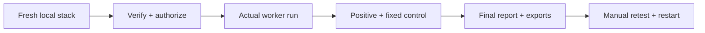

# Production readiness

A release checklist, not evidence that a hosted deployment is ready.
[Public release status](PUBLIC_RELEASE_READINESS.md) lists known implementation
gaps; [acceptance criteria](ACCEPTANCE_CRITERIA.md) defines product behavior.

## Release gates

| Gate | Evidence required |
| --- | --- |
| Reproducible build | Fresh clone, dependency locks, generated Prisma client, correct toolchain, exact image SHA/digests |
| Hosted access | Explicit hosted mode, valid/expired sessions, organization isolation, scoped SSE/downloads |
| Target safety | Verification expiry, private/metadata blocking, DNS/redirect scope tests, approval before sensitive actions |
| Worker runtime | Real tools, timeouts, bounded retries, callback persistence, truthful failure coverage |
| Models | Sanitized context, valid configured providers, tested budgets and fallback |
| Data | Encrypted credentials/session state, sanitized evidence, backup/restore and retention checks |
| Reporting | Canonical snapshot, complete exports, separate latest-status overlay, manual retest result |
| Operations | Queue failure, restart/recovery, cancellation, logs/metrics, rollback evidence |
| Distribution | Existing license policy, third-party notices, contribution-rights review, secret-history review |

Do not treat a CI badge, health endpoint, image build, or empty report as proof of
a successful security assessment.

## Runtime checklist

- [ ] Build the actual services: frontend, public/internal API, findings, reporting,
  orchestrator, browser-inspector, Z/N/O/S/R, and retest.
- [ ] Include optional browser-session only when required and tested.
- [ ] Pin/review upstream images; the current ZAP `stable` tag is mutable.
- [ ] Resolve Nuclei's missing template bundle, environment mismatch, and failure handling.
- [ ] Configure real OpenHack/Strix tools; adapter-only images are not complete runtimes.
- [ ] Verify recon in the chosen deployment; local inclusion does not prove staging rollout.
- [ ] Keep database, queue, callbacks, and adapters off public interfaces.
- [ ] Never deploy passwordless local Compose as a shared/public service.
- [ ] Verify the toolchain against [go.work](../go.work), not only the CI setup version.

## End-to-end acceptance path

Run only on a verified, owned, authorized **public staging target**, after the
known safety blockers are resolved. [Canary fixture](OPENHUNTER_CANARY_CONTRACT.md).

- [ ] Record commit, target authorization, runtime versions, and enabled workers.
- [ ] Complete required target login/captcha/MFA manually.
- [ ] Trace scan creation → NATS dispatch → callbacks → promotion → final report.
- [ ] Confirm vulnerable control yields actual sanitized evidence; fixed control does not.
- [ ] Observe unavailable tools, queue outage, slow callbacks, cancellation, and recovery.
- [ ] Confirm reports preserve finding limits, skipped work, and coverage gaps.
- [ ] Verify long/Unicode exports; current PDF truncation must not be hidden.
- [ ] Request a finding-scoped retest and verify persisted result/latest view.
- [ ] Restart and verify saved data and completed work remain consistent.
- [ ] Retain sanitized browser/API/server evidence; no raw secrets or target traffic.

## Deployment record

For an authorized deployment, record the exact source commit, image digests,
migration state, active service revision, target smoke result, and rollback target.
Check browser behavior and server logs against that revision.

The [staging assets](../infra/) and [historical hosted plan](superpowers/plans/2026-06-16-scan-pipeline-runtime.md)
are references, not standing authority to modify cloud resources.
Do not add CI/CD retests, private-network scanning, or new orchestration platforms
as part of satisfying this checklist.
