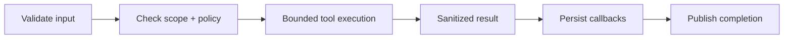

# Worker specification

Runtime reference plus mandatory worker rules. Profiles come from
[scan-plan.ts](../shared/security-core/src/scan-plan.ts); this document does not
grant permission to expand scope or enable additional tools.

## 1. Identity and input

Plan keys, runtime IDs, and Docker service names are different identifiers:

| Plan key | Runtime ID / source | NATS subject | Local service |
| --- | --- | --- | --- |
| `browser` | [browser-inspector](../workers/browser-inspector/) | `worker.browser.run` | `browser-inspector` |
| `zap` | [Z](../workers/Z/) | `worker.zap.run` | `z` |
| `nuclei` | [N](../workers/N/) | `worker.nuclei.run` | `n` |
| `openhack` | [O](../workers/O/) | `worker.openhack.run` | `o` |
| `strix` | [S](../workers/S/) | `worker.strix.run` | `s` |
| `recon` | [R](../workers/R/) | `worker.recon.run` | `r` |
| — | [retest](../workers/retest/) | `retest.requested` | `retest` |

The [orchestrator mapping](../workers/orchestrator/cmd/orchestrator/orchestrator.go)
normalizes aliases for dispatch and fan-in. Reporting is
[backend/reporting](../backend/reporting/), not an enabled scan worker.

The wire contract is [workers/shared/events/events.go](../workers/shared/events/events.go).
Events use `{id, subject, occurredAt, payload}`; fields use camelCase.

| Payload | Fields |
| --- | --- |
| `scan.created` | `scanId`, `projectId`, `authorizationId`, `mode`, `scope`, `scanPlan` |
| `WorkerRunPayload` | Identity, `scanMode`, `targetType`, `authScope`, `testIntensityMode`, `surfaceFlags`, `scanPlan`, allowed/excluded scope, `verifiedDomain`, optional `acceptanceProfile` |
| `worker.completed` | `scanId`, `projectId`, `workerType`, `state`, `signalCount`, `coverageGap` |
| `retest.requested` | Finding/retest IDs, original scan identity, narrow `retestScenario`, verified scope |

Budgets, hunters, and allowed validation level are inside `scanPlan`, not
invented top-level fields. Workers must preserve the authorized scope snapshot.

## 2. Lifecycle and result

The [shared runner](../workers/shared/runner/runner.go) posts steps and signals
before publishing completion. Callback failures trigger delivery retries.
The shared signal-worker consumer has `MaxDeliver=5`; per-worker timeouts are set
in its entry point. Retest has a separate finding-scoped handler.

| Result state | Meaning |
| --- | --- |
| `done` | Worker returned; not proof of a vulnerability or full coverage |
| `skipped` | Unavailable/not-implemented tool or policy-skipped work; coverage gap |
| `failed` | Invalid input, scope rejection, adapter failure, or timeout; coverage gap |

[Result](../workers/shared/worker/worker.go) includes `errorCode`, `errorMsg`,
`coverageGap`, `summary`, sanitized `signals`, timestamps, and optional `meta`.
Typical codes: `TOOL_UNAVAILABLE`, `ADAPTER_ERROR`, `WORKER_TIMEOUT`,
`WORKER_INVALID_INPUT`. A connection failure is not necessarily the same error
as an adapter explicitly reporting an unavailable tool.

All workers must have bounded execution/retries, structured identity-bearing
logs, sanitized output, explicit failures, and audit records for sensitive actions.
No fake success, unrestricted execution, raw credentials, or raw evidence.

## 3. Profiles by target type

These are the exact current planner profiles, not guarantees of tool coverage.

| Target type | Browser | ZAP | Nuclei | OpenHack | Strix | Recon |
| --- | --- | --- | --- | --- | --- | --- |
| `static_content_website` | light | mini | mini | light | candidate_only | light |
| `interactive_web_app` | medium¹ / deep | standard_safe | standard_safe | medium | deep | standard_safe |
| `api_service` | light² / omitted | standard_safe | standard_safe | medium | deep | standard_safe |
| `ai_llm_application` | medium | hygiene | mini | medium | deep | mini |

¹ Medium for `safe_discovery`; deep otherwise.
² Browser enabled only when `has_api_docs=true`.

The planner also records enabled/skipped hunters, validation level, and approval
requirements. Profile names do not override safety rules.

| Scan-mode budget | Free Hunter | AI Black-hat Mindset Check |
| --- | --- | --- |
| Returned / monitored findings | 1 / 1 | 50 / 50 |
| Retests / cooldown days | 1 / 7 | 10 / 0 |
| Hypotheses / validation attempts | 3 / 1 | 20 / 8 |

These scan budgets are separate from [LLM package budgets](LLM_PROVIDER_SPEC.md#budgets).

## 4. Tool responsibilities

| Worker | Boundary |
| --- | --- |
| Browser | Playwright-based observation; optional authorized target-session replay |
| Z | ZAP passive/baseline signals; no active scan by default |
| N | Reviewed-template-only policy; bundle/configuration currently incomplete — do not treat the packaged binary as validated coverage |
| O | Scenario-first hunter adapter; requires an actual configured runtime |
| S | Attacker-style reasoning/validation adapter; approval and intensity gates still apply |
| R | Subdomain/DNS discovery, HTTP probing, crawling; discovered hosts do not expand scope |
| Retest | Explicit user request for one finding; reuses OpenHack adapter |

Missing OpenHack/Strix runtimes reduce coverage and may prevent completion.
Adapter/build details: [integration packaging](../infra/INTEGRATIONS.md).

## 5. Completion and reporting limits

Fan-in finalizes after expected completions, including reported failed/skipped
outcomes. Read the report's coverage and individual steps before judging a run.

Free Hunter's first-valuable-finding **output cap** exists; immediate cancellation
of remaining workers is still a [release gap](PUBLIC_RELEASE_READINESS.md#open-gaps).
A manual retest request and a worker callback alone do not prove that the
finding status or latest-report overlay was updated end to end.
