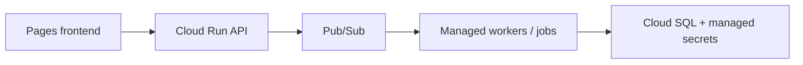

# ADR: Managed scan runtime

**Status: proposed, historical (2026-06-16).** Not implemented by the local-first
workspace. Current runtime: [ARCHITECTURE.md](../ARCHITECTURE.md).

## Context

The June investigation described a hybrid hosted deployment: Pages frontend,
Cloud Run API, and VM-hosted NATS/workers. This is historical context, not verified
current infrastructure state.

## Proposed decision

Keep the hybrid deployment until end-to-end scan acceptance is demonstrated.
A later managed migration was proposed:

This diagram is a proposal only. The checked-in local stack uses NATS and
Postgres; no migration to Pub/Sub is implied or authorized.

## Gates retained

- Typed API failures, scoped/resumable streams where required.
- Bounded workers, retries, structured logs, and explicit tool-failure coverage.
- Sanitized evidence only; no raw HAR, traffic, cookies, tokens, or session data
  in evidence. Dedicated encrypted auth state follows current guardrails.
- Evidence-gated findings, not automatic promotion of passive observations.
- Authorized local/staging E2E, operational observability, and a tested rollback
  before replacing the queue/runtime.

See [production readiness](../PRODUCTION_READINESS.md) for the active acceptance
path. Reopen this decision explicitly before changing architecture.
