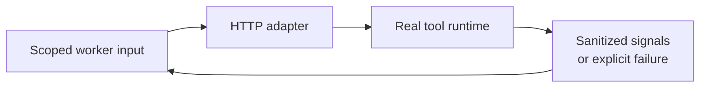

# Integration runtimes

Workers call tool adapters over HTTP; core services do not import upstream tool
internals. Browser inspection belongs to its worker, not a public adapter.



## Local runtime map

| Adapter | Port¹ | Packaged locally | Remaining setup |
| --- | --- | --- | --- |
| [ZAP](../integrations/zaproxy/) | 6100 | Adapter + ZAP daemon | Review mutable upstream tag; passive/baseline policy |
| [Nuclei](../integrations/nuclei/) | 6110 | Adapter + binary | **Blocker:** reviewed templates and effective configuration |
| [OpenHack](../integrations/openhack/) | 6120 | Worker only in default local Compose | Supply a real runtime/adapter; set `OPENHACK_INTEGRATION_URL` |
| [Strix](../integrations/strix/) | 6130 | Worker only in default local Compose | Supply a real runtime/adapter; set `STRIX_INTEGRATION_URL` |
| [Recon](../integrations/recon/) | 6140 | Adapter + subfinder/dnsx/httpx/katana | Maintain scope checks through discovery/probing/crawling |

¹ Internal adapter ports, not ports published by the local stack.
OpenHack/Strix default to Docker-host URLs. Their adapter Dockerfiles alone do not
install upstream runtimes. Do not interpret an adapter health response as a
successful scan.

## Image sources

Values below reflect checked-in Dockerfiles/Compose, not latest-version recommendations.

| Tool | Image |
| --- | --- |
| ZAP | `ghcr.io/zaproxy/zaproxy:stable` |
| Nuclei | `projectdiscovery/nuclei:v3.4.10` |
| Subfinder | `projectdiscovery/subfinder:v2.16.0` |
| dnsx | `projectdiscovery/dnsx:v1.2.2` |
| httpx | `projectdiscovery/httpx:v1.10.0` |
| Katana | `projectdiscovery/katana:v1.7.0` |

The Nuclei Dockerfile uses build argument `NUCLEI_IMAGE`, not
`NUCLEI_UPSTREAM_IMAGE`. Recon's binary-copy stages currently contain literal
image tags; changing a similarly named build argument alone does not replace them.
Review/pin images before distribution.

## Nuclei blocker

The [template directory](../integrations/nuclei/templates/README.md) contains no
reviewed detection templates. Compose passes `NUCLEI_TEMPLATES_DIR` and
`NUCLEI_DISABLE_TEMPLATE_DOWNLOAD`, while the adapter reads `NUCLEI_TEMPLATES`
and does not implement the download flag.

The adapter also ignores most process exit failures. Resolve and test these
issues before scanning; do not claim a curated-only or successful run.
Do not work around the gap by enabling the full community template set.

## Build and contributor workflow

End users: [local setup](../docs/LOCAL_WORKSPACE.md).
Contributor commands below require Bash/Make; they are not the isolated local
Compose entry point and may publish different development ports.

```bash
make up-integration INTEGRATION=zaproxy
make check-integrations
```

The same Make target accepts `nuclei`, `openhack`, `strix`, or `recon`.
Review runtime prerequisites before starting a tool.

Build adapter images without publishing:

```bash
DOCKERHUB_NAMESPACE=<your-namespace> IMAGE_TAG=<git-sha> ops/scripts/publish-images.sh
```

Publishing requires registry authentication, an authorized namespace, and
explicit `PUSH=1`. This document does not claim published images exist under
any example namespace.

No host Docker socket is mounted by local Compose. Discovered assets must remain
pending scope approval until explicitly authorized.
